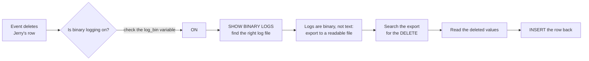

# 03 · Stored Procedures, Triggers, Events and Data Recovery

**Lessons 14 to 15 plus independent practice · MySQL 8.0 · Parks and Recreation database**

> **Overview:** So far my SQL ran only when I pressed *Run*. This stage is about **automation inside the database**: saving a query so it can be re-used (a *stored procedure*), making the database react automatically when data changes (a *trigger*), and making it do things on a timer (an *event*). I also learned the hard way how dangerous automation can be, and how a **binary log** can undo an accident.

| | |
|---|---|
| **Techniques** | `CREATE PROCEDURE` with parameters · `DELIMITER` · `CREATE TRIGGER … AFTER INSERT` · `NEW.` references · `CREATE EVENT` · event scheduler · `SHOW TRIGGERS/EVENTS` · binary-log recovery |
| **Scripts** | [`14. STORED PROCEDURES.sql`](sql/14.%20STORED%20PROCEDURES.sql) · [`15. TRIGGERS and EVENTS.sql`](sql/15.%20TRIGGERS%20and%20EVENTS.sql) · [`practice - trigger and event rough sheet.sql`](sql/practice%20-%20trigger%20and%20event%20rough%20sheet.sql) |


## Lesson 14 · Stored procedures: saved, re-usable queries

**Goal:** save a query under a name so anyone can run it with `CALL`.

```sql
CREATE PROCEDURE large_salaries() SELECT * FROM employee_salary WHERE salary >= 50000;
CALL large_salaries();          -- returns 10 rows
```

**Procedures with several statements** need a temporary change of delimiter. MySQL normally treats `;` as "end of statement", so it would cut the procedure in half. Switching to `$$` tells it "everything up to `$$` is one unit":

```sql
DELIMITER $$
CREATE PROCEDURE large_salaries2()
BEGIN
    SELECT * FROM employee_salary WHERE salary >= 50000;
    SELECT * FROM employee_salary WHERE salary >= 10000;
END $$
DELIMITER ;                     -- always switch back
```
Calling it returns **two result sets**, one per `SELECT`.

**Procedures with a parameter** make the same code reusable for any input:

```sql
DELIMITER $$
CREATE PROCEDURE emp_id_data(p_employee_id INT)
BEGIN
    SELECT * FROM employee_salary WHERE employee_id = p_employee_id;
END $$
DELIMITER ;

CALL emp_id_data(4);
```

| employee_id | first_name | last_name | occupation | salary | dept_id |
|---|---|---|---|---|---|
| 4 | April | Ludgate | Assistant to the Director of Parks and Recreation | 25000 | 1 |

I checked the procedure against the plain query `SELECT * FROM employee_salary WHERE employee_id = 4` and they return the identical row. I also created a procedure through Workbench's "Create Stored Procedure" wizard and compared the template it generates.

> [!TIP]
> `DROP PROCEDURE IF EXISTS name;` before `CREATE` lets a script be re-run without a "procedure already exists" error.


## Lesson 15 · Triggers and events

### Trigger: "when this happens, do that"

**Goal:** whenever a new employee is added to the salary table, automatically create a matching row in the demographics table.

```sql
DELIMITER $$
CREATE TRIGGER employee_insert
    AFTER INSERT ON employee_salary
    FOR EACH ROW
BEGIN
    INSERT INTO employee_demographics (employee_id, first_name, last_name)
    VALUES (NEW.employee_id, NEW.first_name, NEW.last_name);
END $$
DELIMITER ;
```
`NEW` means "the row that was just inserted". After inserting Jean-Raphio Sapaerstein (ID 13) into `employee_salary`, the demographics table gained a row for him automatically. I confirmed it:

| employee_id | first_name | last_name | age | gender | birth_date |
|---|---|---|---|---|---|
| 13 | Jean-Raphio | Sapaerstein | NULL | NULL | NULL |

The trigger can only copy columns the two tables share, which is why age, gender and birth date are `NULL`.

### Event: "do this on a schedule"

```sql
CREATE EVENT delete_retirees
ON SCHEDULE EVERY 30 SECOND
DO DELETE FROM employee_demographics WHERE age >= 60;
```

`SHOW VARIABLES LIKE 'event%'` shows whether the **event scheduler** is on (`event_scheduler = ON`). A practical use is clearing records of retired staff from a system.

> [!WARNING]
> **I tested what this event really does.** About 30 seconds after creating it, Jerry Gergich (age 61) was deleted from `employee_demographics`, exactly as the lesson says. The next section is about what happens next.


## Independent practice: debugging a trigger

[`practice - trigger and event rough sheet.sql`](sql/practice%20-%20trigger%20and%20event%20rough%20sheet.sql)

I tried to extend the trigger to also copy `salary` and `occupation`. That failed with **Error 1136: Column count doesn't match value count**, because the demographics table has no salary or occupation columns. I reproduced it:

| Trigger version | Creating the trigger | Inserting a new employee |
|---|---|---|
| 3 columns listed, 5 values supplied | succeeds | **fails: error 1136** |
| 6 columns listed, `NULL` for those I don't need | succeeds | works |
| 3 columns, 3 values (the lesson's version) | succeeds | works |

Two things I learned that were not obvious from the error message:

1. **A broken trigger can still be created.** MySQL checks the insert only when the trigger *fires*. A trigger that looks fine can fail later, in production.
2. **A failed trigger also cancels the original insert.** When I fired the 5-value trigger, the new employee never reached the salary table either. The two inserts succeed or fail together.

My two fixes (both validated): list only the columns both tables share, **or** list every column of the target table and pass `NULL` for the ones I don't need.

I then rebuilt the trigger from memory and tested it with four inserts; each created a matching demographics row. (The names in the repo copy are fictional.)

Administrative commands I practiced: `DROP TRIGGER IF EXISTS`, `SHOW TRIGGERS`, `SHOW EVENTS`, `DROP EVENT IF EXISTS`.


## Independent practice: recovering deleted data from the binary log

**The incident.** The scheduled event deleted Jerry Gergich. I wanted him back, but his row was gone from the table. This is how I recovered him and what I verified afterwards.



**What I did**
1. Checked that logging was on: `SHOW VARIABLES LIKE 'log_bin';`
2. Listed the log files: `SHOW BINARY LOGS;`
3. Tried `SHOW BINLOG EVENTS IN '<log file>'`, but scrolling through it was impractical and the log is stored in binary format, so I exported it to a readable text file from the Windows command line. (The standard tool is `mysqlbinlog`.)
4. Searched the text for the `DELETE` statement and read the values.
5. Re-inserted the row.

**What the decoded log looks like.** I reproduced the same incident in a test server and decoded its log with `mysqlbinlog -v --base64-output=DECODE-ROWS`. This is the entry for the deletion:

```text
### DELETE FROM `parks_and_recreation`.`employee_demographics`
### WHERE
###   @1=5
###   @2='Jerry'
###   @3='Gergich'
###   @4=61
###   @5='Male'
###   @6='1962:08:28'
```
Each `@n` is a column in order (employee_id, first_name, last_name, age, gender, birth_date). That is everything needed to rebuild the row:

```sql
INSERT INTO employee_demographics (employee_id, first_name, last_name, age, gender, birth_date)
VALUES (5, 'Jerry', 'Gergich', 61, 'Male', '1962-08-28');
```

> [!CAUTION]
> **A gotcha I found while validating.** The lesson-15 event `delete_retirees` is never dropped in the scripts. I re-inserted Jerry in a test server with the event still active, and **it deleted him again within 30 seconds**. Recovery only sticks if you first run:
> ```sql
> DROP EVENT IF EXISTS delete_retirees;
> ```
> `SHOW EVENTS` lists any events still running. Always clean up scheduled jobs after a lesson.

**Why this matters?** Automation (triggers, events) can change data without anyone clicking a button. I thought it essential to know how to audit what happened with the log and also how to undo it. I also learned a reason to *never* test destructive events on data I can't afford to lose.


## Validation summary

| Script | Statements | Result |
|---|---|---|
| Lesson 14 | 15 | all ran, 0 errors |
| Lesson 15 | 7 | all ran, 0 errors; trigger fired; event deleted Jerry within 30 s |
| Rough sheet | 23 | 22 ran; 1 expected failure: `SHOW BINLOG EVENTS` on a log file name that exists only on my Windows PC (error 1220 in the test server) |

Full method and results: [`docs/validation-report.md`](../docs/validation-report.md).

**← Previous:** [02 · Intermediate SQL](../02-intermediate-sql/) · **Next:** [04 · Layoffs data cleaning →](../04-layoffs-data-cleaning/)
