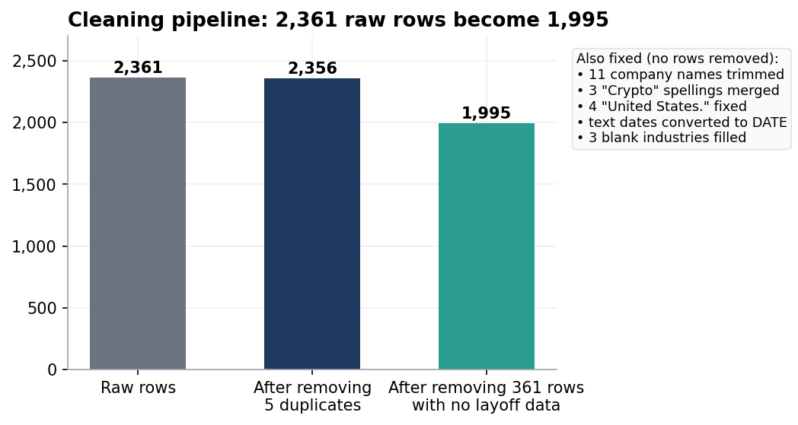
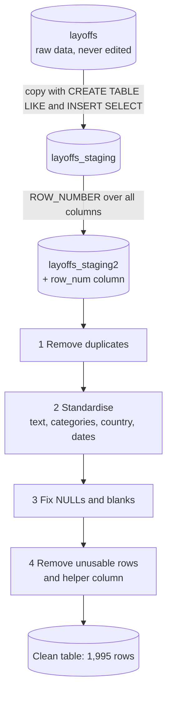

# 04 · Project: Cleaning a Real-World Layoffs Dataset

**Lesson 16 plus an independent re-do · MySQL 8.0 · 2,361 raw rows → 1,995 analysis-ready rows**



> **Overview:** Real data is messy. The same industry is spelled three ways, a country has a stray full stop, dates are stored as text, and some rows are exact copies. If you analyse it without fixing these, your totals and charts are wrong. This project is the "tidy up" step that comes **before** any analysis. The cleaned table feeds the next project, [05 · Layoffs EDA](../05-layoffs-eda/).

## Summary

| | |
|---|---|
| **Business problem** | A table of company layoffs (2020 to 2023) has duplicates, inconsistent labels, text dates and gaps. Make it trustworthy enough to analyse. |
| **Data** | [`data/layoffs.csv`](../data/layoffs.csv): 2,361 rows × 9 columns: `company`, `location`, `industry`, `total_laid_off`, `percentage_laid_off`, `date`, `stage`, `country`, `funds_raised_millions` |
| **Method** | A 4-step workflow on a **copy** of the data (the raw table is never touched) |
| **Result** | 5 duplicates removed · 11 names trimmed · 3 industry spellings merged · 4 country values fixed · dates converted to a real `DATE` type · 3 blanks filled · 361 empty rows removed resulting in a final **1,995 rows** |
| **Techniques** | staging tables · `ROW_NUMBER()` window function · CTEs · `TRIM` · `STR_TO_DATE` · `ALTER TABLE` · self-join `UPDATE` · NULL vs blank handling |
| **Scripts** | [`16. DATA CLEANING.sql`](sql/16.%20DATA%20CLEANING.sql) (guided) · [`practice - data cleaning rough sheet.sql`](sql/practice%20-%20data%20cleaning%20rough%20sheet.sql) (my independent re-do) |
| **Set-up** | [`setup/03_import_layoffs.sql`](../setup/03_import_layoffs.sql) |

## The workflow



> [!IMPORTANT]
> **Why a copy?** In a workplace the raw table may feed other reports and a mistake must be recoverable. Every edit below happens on `layoffs_staging2`. The original `layoffs` stays at 2,361 rows.


## Step 1 · Remove duplicates

**The challenge:** the table has no ID column, so there is no easy way to say "this row is the copy". The solution is to number identical rows with a **window function** and delete the ones numbered 2 or higher.

```sql
WITH duplicate_cte AS (
    SELECT *, ROW_NUMBER() OVER (
        PARTITION BY company, location, industry, total_laid_off,
                     percentage_laid_off, `date`, stage, country, funds_raised_millions
    ) AS row_num
    FROM layoffs_staging
)
SELECT * FROM duplicate_cte WHERE row_num > 1;
```

| company | location | total_laid_off | date | row_num |
|---|---|---|---|---|
| Casper | New York City | NULL | 9/14/2021 | 2 |
| Cazoo | London | 750 | 6/7/2022 | 2 |
| Hibob | Tel Aviv | 70 | 3/30/2020 | 2 |
| Wildlife Studios | Sao Paulo | 300 | 11/28/2022 | 2 |
| Yahoo | SF Bay Area | 1600 | 2/9/2023 | 2 |

These **5 rows** are exact copies (Yahoo, Wildlife Studios, Cazoo, Casper, Hibob). Each company has two identical rows: the first is numbered 1 (kept), the second 2 (deleted).

### Mistake I caught: the false duplicate (Oda)

My first attempt partitioned by only *some* columns, and it flagged the company **Oda** as a duplicate. Checking the data showed why that was wrong:


| company | location | total_laid_off | percentage_laid_off | country | funds_raised_millions |
|---|---|---|---|---|---|
| Oda | Oslo | 70 | 0.18 | Sweden | 377 |
| Oda | Oslo | 70 | 0.18 | Norway | 477 |
| Oda | Oslo | 70 | 0.06 | Norway | 479 |

The three Oda rows share a name, city and headcount, but **differ in country and percentage**. They are separate records, so deleting one would destroy real data. The lesson: partition by **every** column, then verify a suspected duplicate by looking at the rows yourself (Casper, by contrast, was a true copy).

### A second obstacle: you cannot `DELETE` from a CTE

> **MySQL error 1288:** `The target table duplicate_cte of the DELETE is not updatable`

**Fix:** write the numbered rows into a real table, `layoffs_staging2`, which has an extra `row_num` column, then delete from *that*. Result: `DELETE` removes **5 rows**, leaving **2,356**.


## Step 2 · Standardise the data

"Standardise" means making the same thing look the same everywhere.

| Problem | Before | After | Fix | Rows changed |
|---|---|---|---|---|
| Extra spaces around names | `[WeWork ]`, `[ E Inc.]`, `[ Included Health]`… | `WeWork`, `E Inc.`, `Included Health` | `UPDATE … SET company = TRIM(company)` | **11** |
| One industry, three spellings | `Crypto` (99) · `Crypto Currency` (2) · `CryptoCurrency` (1) | `Crypto` | `WHERE industry LIKE 'Crypto%'` | **3** |
| Stray full stop | `United States.` (Indigo, Palantir, Twilio, Landing) | `United States` | `TRIM(TRAILING '.' FROM country)` | **4** |
| Dates stored as text | `3/6/2023` | `2023-03-06` (a true `DATE`) | `STR_TO_DATE(date, '%m/%d/%Y')` then `ALTER TABLE … MODIFY COLUMN date DATE` | **2,355** |

> [!NOTE]
> **Why 2,355 and not 2,356 dates?** One record (Blackbaud) has no date at all. `STR_TO_DATE(NULL)` stays `NULL`, so it was correctly left alone. It is the only NULL date in the table.

**Two details that matter**
- Plain `TRIM(country)` would **not** remove a full stop. `TRIM` only strips spaces unless you tell it the character: `TRIM(TRAILING '.' FROM country)`.
- Converting text to a date takes **two** steps. `STR_TO_DATE` fixes the *values*, but the column is still text until `ALTER TABLE … MODIFY COLUMN` changes its *type*. Without the second step, date functions like `YEAR()` behave unreliably.


## Step 3 · NULLs and blank values

Four rows had a missing industry: three stored as a **blank string** (`''`) and one as a true `NULL`.

| Company | Problem | Fix |
|---|---|---|
| Airbnb | blank | filled with **Travel** (it appears elsewhere in the data as Travel) |
| Carvana | blank | filled with **Transportation** |
| Juul | blank | filled with **Consumer** |
| Bally's Interactive | `NULL` | **left as NULL**: there was only one record, so no reference to copy from |

The method is a **self join**: join the table to itself on `company`, and copy the industry from a row that has one into a row that doesn't.

```sql
UPDATE layoffs_staging2 t1
JOIN layoffs_staging2 t2 ON t1.company = t2.company
SET t1.industry = t2.industry
WHERE t1.industry IS NULL AND t2.industry IS NOT NULL;
```

### Mistake I debugged: "0 rows affected"
My first run of this update changed **nothing**. The cause was blank strings: `''` is not `NULL`, so the `IS NULL` test never matched the blank rows. Converting blanks to NULL first fixed it:

```sql
UPDATE layoffs_staging2 SET industry = NULL WHERE industry = '';   -- 3 rows
```
After that the self-join updated all **3** rows.

> [!TIP]
> **Blank (`''`) and `NULL` look identical on screen but behave differently.** Always check for both.


## Step 4 · Remove what cannot be used

Rows where **both** `total_laid_off` and `percentage_laid_off` are missing say a layoff happened but not how big, so they cannot support any layoff analysis.

```sql
DELETE FROM layoffs_staging2
WHERE total_laid_off IS NULL AND percentage_laid_off IS NULL;   -- 361 rows
ALTER TABLE layoffs_staging2 DROP COLUMN row_num;                -- helper column no longer needed
```

> [!NOTE]
> **A trade-off worth stating.** Deleting these rows does not change any layoff *totals* (a `NULL` adds nothing to a `SUM`), but it does lower the *count of layoff events and companies*. 361 rows is 15% of the table, so for a different question, such as "how many companies had layoffs?", this decision would need revisiting.

## Results

| Stage | Rows |
|---|---|
| Raw `layoffs` table | 2,361 |
| After removing duplicates | 2,356 |
| **Final clean table** | **1,995** |


## Independent re-do

[`practice - data cleaning rough sheet.sql`](sql/practice%20-%20data%20cleaning%20rough%20sheet.sql) repeats the whole workflow from memory with different table names (`layoffs_dc` → `layoffs_clean`). Differences in approach:

- I filled the industries **two ways**: *Method 1* looked up each company by hand (`Airbnb → Travel`, etc.), *Method 2* used the self-join. Because Method 1 ran first, Method 2 reported **0 rows affected**, which itself proved the manual fixes were complete. For thousands of gaps, Method 2 is the only practical choice.
- I added written reminders of every trap above (blanks before NULL, `MODIFY COLUMN` after `STR_TO_DATE`, drop `row_num` last).

**Check:** I compared `layoffs_clean` with the guided `layoffs_staging2` using `EXCEPT` in both directions. **0 rows differ**, so my independent work produces an identical table.


## What the clean table still has (data-quality notes)

Cleaning is never "finished". These remaining items are documented rather than hidden. Re-run [`tests/01_layoffs_cleaning_checks.sql`](../tests/01_layoffs_cleaning_checks.sql) to see each one.

| Observation | Count | Why it matters |
|---|---|---|
| `percentage_laid_off` is still stored as **text** | 1,572 values | works for filtering, but a numeric type is safer for maths |
| `total_laid_off` missing (but percentage present) | 378 rows | these rows are invisible to headcount totals |
| `Fin-Tech` and `Finance` are separate industries | 3 vs 239 rows | possibly the same category; a business decision |
| One NULL date (Blackbaud, 500 people) | 1 row | falls into a "no year" bucket in yearly totals |
| One NULL industry (Bally's Interactive) | 1 row | no source to infer it from |
| `funds_raised_millions` missing | 165 rows | also **repeats per company**, which causes a trap in project 05 |

## Validation

| Check | Result |
|---|---|
| Lesson 16 script: 47 statements | all ran; 1 expected error (`DELETE` from a CTE, error 1288) |
| Rows: raw -> cleaned | 2,361 -> 1,995  |
| Whitespace / blanks / trailing dots / Crypto variants left | 0  |
| Duplicates after standardising | 0  |
| Independent re-do equals guided result | 0 differing rows  |

Full method: [`docs/validation-report.md`](../docs/validation-report.md).

**← Previous:** [03 · Procedures, triggers, events](../03-procedures-triggers-events/) · **Next:** [05 · Layoffs EDA →](../05-layoffs-eda/)
