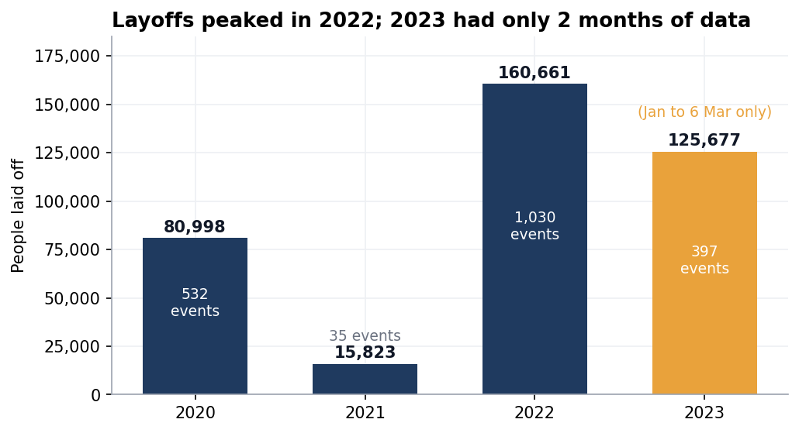
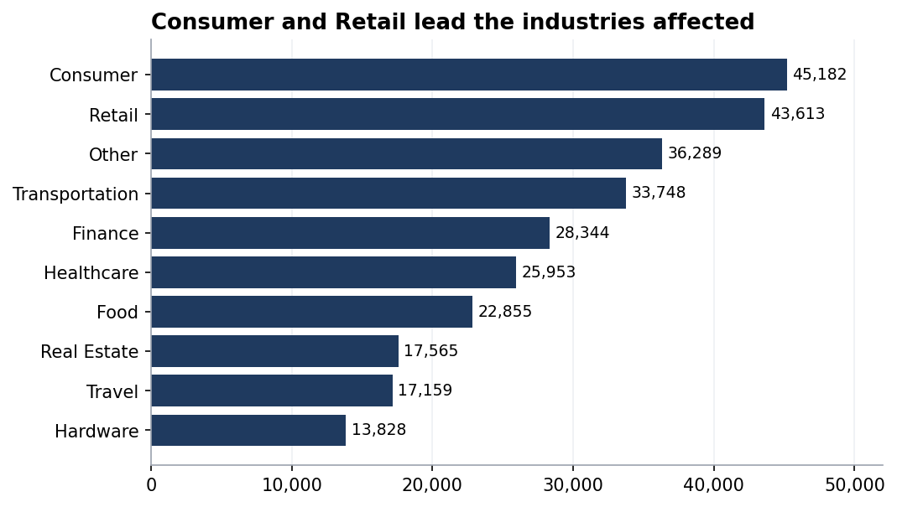
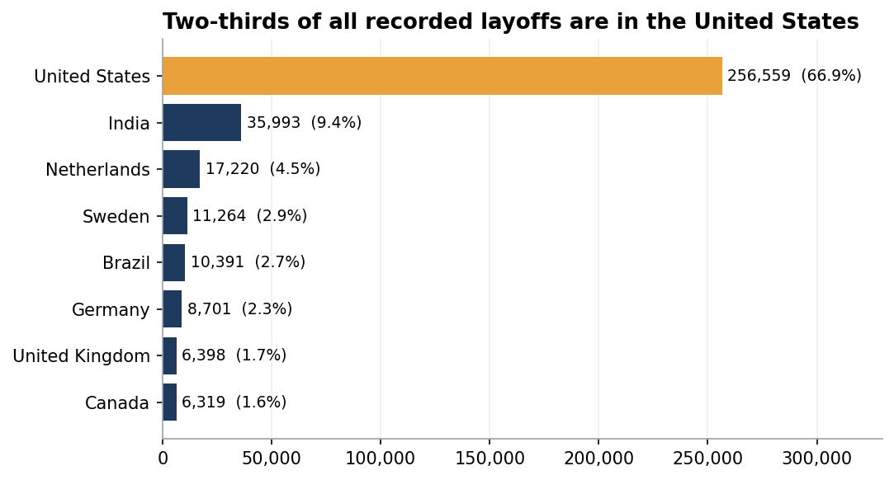

# 05 · Project: Exploring Global Tech Layoffs (2020 to 2023)

**Lesson 17 plus an independent re-do and extension · MySQL 8.0 · 1,995 cleaned records**



> **Overview:** With the data cleaned in [project 04](../04-layoffs-data-cleaning/), I asked it questions. *Which companies cut the most jobs? Which industries and countries? When did it peak?* This is called **exploratory data analysis (EDA)**; looking for patterns and checking whether they can be trusted.

## Summary

- **383,659 people** were recorded as laid off between **11 March 2020** and **6 March 2023**, across 1,628 companies in 51 countries.
- **Two waves.** An early shock in spring 2020 (about 62,000 between March and May), then a far larger one from **November 2022 to February 2023**: Nov 2022 (53,451) and **January 2023 (84,714), the single worst month**.
- **Big tech dominates the headlines**: Amazon (18,150), Google (12,000), Meta (11,000), Salesforce (10,090) and a tie between Microsoft and Philips (10,000 each). The top five alone are **16%** of all layoffs, which means most layoffs came from a long tail of smaller companies.
- **Consumer and Retail** are the hardest-hit industries (45,182 and 43,613). The **United States** accounts for **66.9%** of all recorded layoffs (256,559), followed by India (35,993, 9.4%).
- **Post-IPO (publicly listed) companies** account for 204,132 layoffs, **53%** of the total.
- **116 layoff events were total shutdowns** (100% of staff). The best-funded was **Britishvolt** ($2.4 billion raised).
- **Two traps found in my own work and fixed** (see [section below](#bug-found-while-validating-summing-funds-raised-double-counts)): summing `funds_raised_millions` per company roughly **doubles** the real total, and a "top 5" silently hid a tie.

| | |
|---|---|
| **Data** | `layoffs_staging2` (1,995 rows) produced by [project 04](../04-layoffs-data-cleaning/) |
| **Techniques** | aggregation (`SUM`, `MAX`, `AVG`) · `GROUP BY` on several dimensions · date functions · CTEs · rolling totals · `DENSE_RANK() OVER (PARTITION BY …)` · scalar subqueries · critical checking of results |
| **Scripts** | [`17. EXPLORATORY DATA ANALYSIS (EDA).sql`](sql/17.%20EXPLORATORY%20DATA%20ANALYSIS%20%28EDA%29.sql) (guided) · [`practice - eda practice sheet 1.sql`](sql/practice%20-%20eda%20practice%20sheet%201.sql) (my own extension) |
| **Checks** | [`tests/02_layoffs_eda_checks.sql`](../tests/02_layoffs_eda_checks.sql) |


## Question 1 · How big and how bad was it?

```sql
SELECT MAX(total_laid_off), MAX(percentage_laid_off) FROM layoffs_staging2;
```

| MAX(total_laid_off) | MAX(percentage_laid_off) |
|---|---|
| 12000 | 1 |

- The largest single layoff event was **12,000 people** (Google, 20 January 2023).
- The largest percentage is **1 which is 100% of the company**. Those are total shutdowns.

**Which fully-closed companies had raised the most money?**

```sql
SELECT * FROM layoffs_staging2 WHERE percentage_laid_off = 1 ORDER BY funds_raised_millions DESC;
```

| company | location | industry | total_laid_off | date | funds_raised_millions |
|---|---|---|---|---|---|
| Britishvolt | London | Transportation | 206 | 2023-01-17 | 2400 |
| Quibi | Los Angeles | Media | NULL | 2020-10-21 | 1800 |
| Deliveroo Australia | Melbourne | Food | 120 | 2022-11-15 | 1700 |
| Katerra | SF Bay Area | Construction | 2434 | 2021-06-01 | 1600 |
| BlockFi | New York City | Crypto | NULL | 2022-11-28 | 1000 |
| Aura Financial | SF Bay Area | Finance | NULL | 2021-01-11 | 584 |

<sub>Showing the first 6 of 116 rows.</sub>

<sub>`funds_raised_millions` is in millions of US dollars, so 2,400 = $2.4 billion. Where `total_laid_off` is NULL the headcount was not reported.</sub>

Of the 116 total shutdowns, 73 have no reported headcount. The 43 that do add up to 8,381 people, and the most common industries are Food (13), Retail (13) and Finance (12).


## Question 2 · Who laid off the most employees?


```sql
SELECT company, SUM(total_laid_off) FROM layoffs_staging2 GROUP BY company ORDER BY 2 DESC;
```

| company | SUM(total_laid_off) |
|---|---|
| Amazon | 18150 |
| Google | 12000 |
| Meta | 11000 |
| Salesforce | 10090 |
| Microsoft | 10000 |
| Philips | 10000 |
| Ericsson | 8500 |

<sub>Showing the first 7 of 1,628 rows.</sub>

- Amazon had the most layoffs with a total of 18,150 layoffs, Google ranks second with 12,000 layoffs and trailing right behind with 11,000 employees laid off is Meta.

> [!Note]
> **Rank 5 is a tie.** Microsoft and Philips both total exactly 10,000. A `LIMIT 5` would silently drop one of them. When ranking, check for ties, or use `RANK()`, which shows both.


## Question 3 · Which industries and countries had the most layoffs?



```sql
SELECT industry, SUM(total_laid_off)
FROM layoffs_staging2
GROUP BY industry
ORDER BY 2 DESC;
```

| industry | SUM(total_laid_off) |
|---|---|
| Consumer | 45182 |
| Retail | 43613 |
| Other | 36289 |
| Transportation | 33748 |
| Finance | 28344 |
| Healthcare | 25953 |
| Food | 22855 |
| Real Estate | 17565 |

<sub>Showing the first 8 of 31 rows.</sub>

- The Consumer industry had the most layoffs with a total of 45,182 layoffs. The next is the Retail industry followed by Other industry with respectively 43,613 and 36,289 layoffs.



```sql
SELECT country, SUM(total_laid_off)
FROM layoffs_staging2
GROUP BY country
ORDER BY 2 DESC;
```

| country | SUM(total_laid_off) |
|---|---|
| United States | 256559 |
| India | 35993 |
| Netherlands | 17220 |
| Sweden | 11264 |
| Brazil | 10391 |
| Germany | 8701 |
| United Kingdom | 6398 |
| Canada | 6319 |

<sub>Showing the first 8 of 51 rows.</sub>

- The United States is the country with the most layoffs, 256,559, accounting for nearly two-thirds of the total layoffs. It is important to note that because the data comes from public layoff trackers, it is likely **biased toward US tech and heavily reported companies**, so this is a statement about *recorded* layoffs, not about the world economy.

**By funding stage.** Mature, publicly listed companies led the cuts in the total amount of layoffs.


| stage | SUM(total_laid_off) |
|---|---|
| Post-IPO | 204132 |
| Unknown | 40716 |
| Acquired | 27576 |
| Series C | 20017 |
| Series D | 19225 |
| Series B | 15311 |

<sub>Showing the first 6 of 17 rows.</sub>


## Question 4 · When did the layoffs happen?


I grouped by month using `SUBSTRING(date, 1, 7)` (e.g. `2022-11`), then used a window function to build a **rolling total** that accumulates month by month to get the timeline of the layoff events.

```sql
WITH Rolling_Total AS (
    SELECT SUBSTRING(`date`, 1, 7) AS `MONTH`, SUM(total_laid_off) AS total_off
    FROM layoffs_staging2
    WHERE SUBSTRING(`date`, 1, 7) IS NOT NULL
    GROUP BY `MONTH`
)
SELECT `MONTH`, total_off, SUM(total_off) OVER (ORDER BY `MONTH`) AS rolling_total
FROM Rolling_Total;
```

| MONTH | total_off | rolling_total |
|---|---|---|
| 2020-03 | 9628 | 9628 |
| 2020-04 | 26710 | 36338 |
| 2020-05 | 25804 | 62142 |
| 2020-06 | 7627 | 69769 |
| 2020-07 | 7112 | 76881 |

<sub>Showing the first 5 of 36 rows.</sub>

| Month | People laid off |
|---|---|
| **2023-01** | **84,714** (peak) |
| 2022-11 | 53,451 |
| 2023-02 | 36,493 |
| 2020-04 | 26,710 |
| 2020-05 | 25,804 |

- The rolling total reaches **383,159** by March 2023. (It is 500 lower than the 383,659 grand total because the one undated record, Blackbaud, cannot be placed in a month.)

**Year by year summary for Layoff events**- This is extra insight gained after scrutinizing the timeline for the layoffs.

| Year | People laid off | Layoff events | Note |
|---|---|---|---|
| 2020 | 80,998 | 532 | pandemic shock |
| 2021 | 15,823 | **35** | very few events recorded |
| 2022 | 160,661 | 1,030 | highest full year |
| 2023 | 125,677 | 397 | **only Jan to 6 Mar** |
| (no date) | 500 | 1 | Blackbaud |

> [!IMPORTANT]
> **Reading the 2021 dip carefully.** 2021 has only 35 recorded events against 532, 1,030 and 397 for the other years. I believe this possibly points to **sparse data collection** in 2021, so I would not claim "2021 was a quiet year" without more evidence. Likewise 2023 has only about two months worth of data, so it cannot be compared with full years eventhough its pace is the fastest in the dataset.


## Question 5 · Which company led each year?

I ranked companies *within each year* with `DENSE_RANK() OVER (PARTITION BY years ORDER BY total_laid_off DESC)` and kept ranks 1 to 5:

```sql
WITH Company_Year (company, years, total_laid_off) AS (
    SELECT company, YEAR(`date`), SUM(total_laid_off) FROM layoffs_staging2 GROUP BY company, YEAR(`date`)
),
Company_Year_Rank AS (
    SELECT *, DENSE_RANK() OVER (PARTITION BY years ORDER BY total_laid_off DESC) AS Ranking
    FROM Company_Year WHERE years IS NOT NULL
)
SELECT * FROM Company_Year_Rank WHERE Ranking <= 5;
```

| company | years | total_laid_off | Ranking |
|---|---|---|---|
| Uber | 2020 | 7525 | 1 |
| Booking.com | 2020 | 4375 | 2 |
| Groupon | 2020 | 2800 | 3 |
| Swiggy | 2020 | 2250 | 4 |
| Airbnb | 2020 | 1900 | 5 |
| Bytedance | 2021 | 3600 | 1 |
| Katerra | 2021 | 2434 | 2 |
| Zillow | 2021 | 2000 | 3 |
| Instacart | 2021 | 1877 | 4 |
| WhiteHat Jr | 2021 | 1800 | 5 |
| Meta | 2022 | 11000 | 1 |
| Amazon | 2022 | 10150 | 2 |
| Cisco | 2022 | 4100 | 3 |
| Peloton | 2022 | 4084 | 4 |
| Carvana | 2022 | 4000 | 5 |
| Philips | 2022 | 4000 | 5 |
| Google | 2023 | 12000 | 1 |
| Microsoft | 2023 | 10000 | 2 |
| Ericsson | 2023 | 8500 | 3 |
| Amazon | 2023 | 8000 | 4 |
| Salesforce | 2023 | 8000 | 4 |
| Dell | 2023 | 6650 | 5 |

| Year | #1 | People |
|---|---|---|
| 2020 | Uber | 7,525 |
| 2021 | Bytedance | 3,600 |
| 2022 | Meta | 11,000 |
| 2023 | Google | 12,000 |

- Uber, Bytedance, Meta and Google are the companies that had the most layoffs for the years 2020, 2021, 2022 and 2023 respectively.

The gap in the amount of layoffs corresponding to 2022 and 2023 leaders, and those of 2020 and 2021, gives credibility to the "two waves" story. The query returns 22 rows (not 20) because `DENSE_RANK` lets tied companies share a rank.


## Independent re-do and extension

[`practice - eda practice sheet 1.sql`](sql/practice%20-%20eda%20practice%20sheet%201.sql) runs on my own cleaned table `layoffs_clean`. I rebuilt the lesson and added **profiling** and **named lookups**.

**Dataset profile** (`COUNT(DISTINCT …)`)

| Column | Distinct values |
|---|---|
| company | 1,628 |
| location | 168 |
| industry | 30 |
| country | 51 |
| stage | 16 |

**Summary statistics**

| Measure | `total_laid_off` | `funds_raised_millions` |
|---|---|---|
| Max | 12,000 | 121,900 |
| Min | 3 | 0 |
| Sum | 383,659 | 1,601,450 *(see below)* |
| Average | 237.27 | 875.11 |

**Named lookups with a scalar subquery:** "which company is behind the extreme?"

```sql
SELECT company AS Company_With_Max_Layoffs
FROM layoffs_clean
WHERE total_laid_off = (SELECT MAX(total_laid_off) FROM layoffs_clean);   -- Google
```
Most layoffs: **Google** (12,000 people on 20 Jan 2023). Fewest layoffs: **Branch** (3 people on 11 June 2020).

> [!NOTE]
> `COUNT(DISTINCT company)` returns **1,628** in MySQL. While validating with the help of the AI assistant I learned that a case-sensitive tool such as pandas would report 1,633. This is because MySQL's default collation ignores case and accents and treats near-identical names as one. This is worth knowing when comparing numbers across tools.


## Bug found while validating: summing "funds raised" double-counts


**What I did:** `SELECT company, SUM(funds_raised_millions) … GROUP BY company` and the same by country.

**What went wrong:** `funds_raised_millions` describes the **company** (how much money it raised in total), but the table has **one row per layoff event**. A company that laid people off four times has its funding repeated on four rows, and `SUM` adds it four times.

| Company | Layoff rows | Naive `SUM` | Correct (`MAX` per company) |
|---|---|---|---|
| Netflix | 4 | 487,600 | 121,900 |
| Uber | 5 | 123,500 | 24,700 |
| WeWork | 6 | 85,200 | 43,950 |
| Twitter | 4 | 44,400 | 18,600 |
| **All companies** | 1,995 | **1,767,276** | **876,286** |

The naive total is **almost double** the real one. The same inflation affects the by-country view (United States: 1,220,998 naive vs 496,623 correct).

**The rule I took from it:** *before you `SUM` a column, ask what one row represents.* A value that belongs to a *company* must be counted once per company, not once per event.

```sql
WITH total_funds as
(SELECT DISTINCT company, max(funds_raised_millions) funds
FROM layoffs_clean
GROUP BY company
)
SELECT sum(funds)
FROM total_funds
;     -- 876,286
```

**Related findings from the same check**
- "Which company raised the most money?" returned **Netflix four times** (one row per layoff event). `SELECT DISTINCT` gives one answer.
- **Netflix's 121,900 ($121.9 billion) looks like a data-entry scale error.** It is probably a unit mistake in the source data and should be verified before anyone relies on it.
- 78 companies have **different** funding values on different rows (they raised more between layoffs), so `MAX` means "latest known value".
- 6 rows show 0 funds raised (5 companies). That may mean "unknown" rather than zero.

> [!NOTE]
> The lesson script originally included a query that summed `percentage_laid_off` by company. Adding percentages from separate events is not meaningful (50% + 50% is not "100% of the company"), so I removed it from the final script.


## Limitations and what I would do next

| Limitation | Why it matters |
|---|---|
| Layoff data are **recorded events**, not a census | US tech is likely over-represented |
| 2021 has very few events; 2023 covers 2 months | year-to-year comparisons are unreliable |
| Headcount missing in 378 rows | totals are **lower bounds** |
| `percentage_laid_off` is text | cast to `DECIMAL` before doing maths |
| No company size | a 5,000-person cut at a 500,000-person company is not like one at a 6,000-person company |

**Next steps:** normalise by company size (percentages), build a dashboard in Tableau or Power BI, and test whether funding stage or industry explains the timing of the 2022 to 2023 wave.

## Validation

| Check | Result |
|---|---|
| Lesson 17 script: 15 statements | all ran, 0 errors |
| Independent sheet: 26 statements | all ran, 0 errors |
| All headline numbers re-calculated in an independent tool (Python/pandas) | match, apart from the case-sensitivity difference in distinct counts noted above |
| `layoffs_clean` vs `layoffs_staging2` | identical |

Full method: [`docs/validation-report.md`](../docs/validation-report.md).

**← Previous:** [04 · Data cleaning](../04-layoffs-data-cleaning/) · **Next:** [06 · EDA practice database →](../06-eda-practice-database/)
