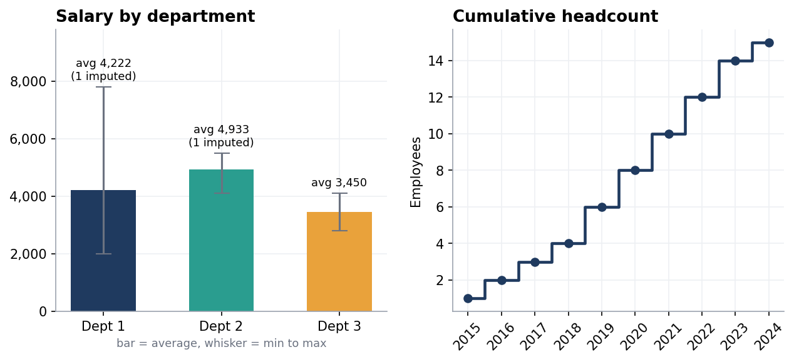
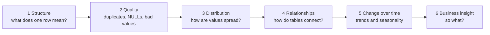

# 06 · Project: Exploratory Data Analysis on a Nine-Table Practice Database

**Independent project · MySQL 8.0 · database `eda_practice`**



> **Overview:** The bootcamp taught me the SQL commands. This project tests whether I can **think like an analyst** on data I had not seen before. I built a small database of nine tables with synthetic data, each shaped like a different real-world problem (HR records, tweets, revenue, online orders, ad clicks…), then explored them step by step. Some tables hide deliberate traps (duplicates, missing values, inconsistent records) and part of the job was finding them.

## How I approached every table

I followed this six-step order for professional analysis.



For each finding I asked, *"What would someone do differently because of this number?"* I also scaled the effort to the table; a clean, simple table got a quick check, a messy one got a proper investigation.

## The tables

| Table | What one row is | Rows | Seeded issue / feature | Report | Status |
|---|---|---|---|---|---|
| `employees` | one employee | 15 | 2 missing salaries · 3 structural NULL managers | [employees](reports/employees.md) | cleaned + 5 analyses |
| `job_listings` | one job posting | 8 | 2 pairs of exact duplicates | [below](#job_listings-duplicate-detection) | duplicate detection |
| `tweets` | one tweet | 400 | repeated user/date pairs are *valid* | [tweets](reports/tweets.md) | histogram + weekday pattern |
| `monthly_revenue` | one month of 2023 | 12 | hidden down months | [monthly revenue](reports/monthly_revenue.md) | growth + moving average |
| `users` / `orders` | one user / one order | 6 / 4 | 3 users never ordered | [users and orders](reports/users_and_orders.md) | integrity check + anti-join |
| `events` | one ad impression or click | 15 | a click needs an impression | [events](reports/events.md) | funnel check + CTR |
| `logins` | one login | 10 | n/a | | not started |
| `transactions` | one payment | 15 | $2,500 and $1.00 outliers | | not started |

Set-up script: [`setup/02_create_eda_practice.sql`](../setup/02_create_eda_practice.sql). It uses fixed data, so anyone who runs it gets exactly the numbers shown here.

## Main findings

| Table | Finding | Technique |
|---|---|---|
| employees | Department 1 has the widest pay spread (2,000 to 7,800, standard deviation about 2,020), so its **average (4,222) is the least representative** | `AVG`, `STDDEV`, `RANK` |
| employees | One manager, Noah Brown, has **7 direct reports** spanning two departments. The other managers have 3, 1 and 1 | self join, `LEFT JOIN` + `COUNT` |
| tweets | 30 users tweet 13 times on average; **2 heavy users (20+ tweets)**. The weekday differences are **not statistically significant** (p ≈ 0.058) | `CASE` + CTE histogram, chi-square check |
| monthly_revenue | Revenue grew **80%** (10,000 -> 18,000), yet **March, June and September fell**. Every *quarter* still beat the one before | `LAG`, moving average |
| users / orders | **3 of 6 users (50%) never ordered** | `LEFT JOIN … IS NULL` |
| events | CTR is **60% / 25% / 0%** for apps 1, 2, 3, but each rate rests on only 2 to 5 impressions. Averaging daily rates gives the *wrong* answer (66.7% vs 60%) | conditional aggregation, `NULLIF` |

## job_listings: duplicate detection

A *duplicate* here means the same company posted the same title and description twice. I defined it on `company_id + title + description`, **not** on `job_id`, because `job_id` is unique per row by design.

```sql
SELECT *, ROW_NUMBER() OVER (PARTITION BY company_id, title, description ORDER BY job_id) AS row_num
FROM job_listings;       -- row_num > 1 means "this is a repeat"
```

| job_id | company | title | row_num | verdict |
|---|---|---|---|---|
| 1 | 101 | Data Analyst | 1 | keep |
| **2** | 101 | Data Analyst | **2** | **duplicate of job 1** |
| 4 | 102 | Data Analyst | 1 | keep |
| 5 | 102 | Data Analyst | 1 | keep: **different description**, so *not* a duplicate |
| 6 | 103 | Product Manager | 1 | keep |
| **7** | 103 | Product Manager | **2** | **duplicate of job 6** |

<sub>Jobs 3 (Software Engineer) and 8 (Data Scientist) are unique and omitted for brevity.</sub>

**Bug I learned from:** adding `job_id` to the `PARTITION BY` makes every row unique, so every `row_num` is 1 and **no duplicates are ever found**. A quick sanity test is `SELECT MAX(row_num)`; if it equals 1, the partition is too specific. (I confirmed this: `MAX = 1` with `job_id` included.)


## What these exercises taught me

1. **Define "duplicate" before searching.** Understand what qualifies as a duplicate for each context the dataset applies to. Also avoid partitioning by the primary key to ensure duplicates are accurately detected.
2. **Not every NULL is an error.** Three missing `manager_id` values simply mean "top of the management chain" and must be left alone. The two missing salaries are genuinely missing data.
3. **Flag, don't overwrite.** I kept the original salary column untouched and added an estimate plus an `is_imputed` flag, so every result can say how many numbers are guesses.
4. **Never average rates.** Add the counts, then divide.
5. **Small data needs honest caveats.** With 15 people or 11 impressions, patterns are suggestive at best.
6. **Break your own checks.** I inserted a fake click to confirm my funnel check catches it, then deleted it.

All the mistakes I made along the way, with explanations, are collected in [`docs/debugging-log.md`](../docs/debugging-log.md).

## Roadmap

- [ ] `logins`: duplicate/completeness checks, then Day-1 to Day-2 retention using a self join
- [ ] `transactions`: outlier detection. A simple "2 standard deviations" rule only catches the $2,500, because the extreme value inflates the standard deviation (**outlier masking**). A median/IQR method is the planned fix.
- [ ] Charts for each table (a first set is in [`images/`](../images/))
- [ ] Repeat this workflow on a larger, real public dataset

## Validation

| Script | Statements | Result |
|---|---|---|
| `EDA practice_employees.sql` | 49 | all ran, 0 errors |
| `EDA practice_tweets.sql` | 12 | all ran, 0 errors |
| `EDA practice_monthly _revenue.sql` | 9 | all ran, 0 errors |
| `EDA practice_users&orders.sql` | 10 | all ran, 0 errors |
| `EDA practice_events.sql` | 9 | all ran, 0 errors |
| Errors and Corrections (employees) | 8 | all ran, 0 errors |
| Errors and Corrections (events) | 5 | 1 error by design |

Full method: [`docs/validation-report.md`](../docs/validation-report.md).

**← Previous:** [05 · Layoffs EDA](../05-layoffs-eda/) · **Back to** [main README](../README.md)
