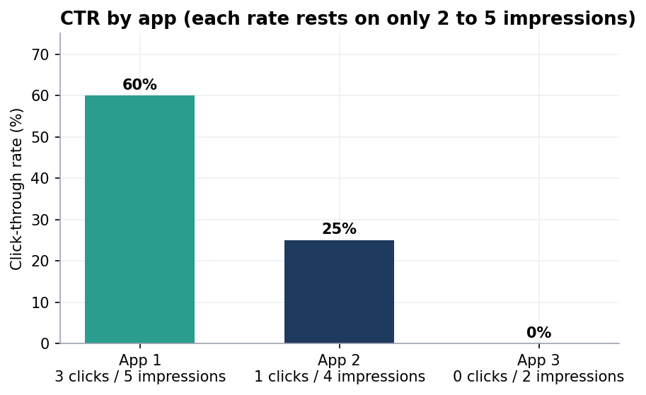

# Report · `events`

[← Back to project 06](../README.md)

> **Overview:** This is a log of ad **impressions** (an ad was shown) and **clicks** (someone clicked it) for three apps. The key metric is **click-through rate (CTR)**: clicks ÷ impressions. Calculating it correctly is trickier than it sounds.

**Scripts:** [`EDA practice_events.sql`](../sql/EDA%20practice_events.sql) · [`Errors and Corrections for EDA practice_events table.sql`](../sql/Errors%20and%20Corrections%20for%20EDA%20practice_events%20table.sql)



| Column | Meaning |
|---|---|
| `event_id` | unique ID |
| `app_id` | 1, 2 or 3 |
| `event_type` | `impression` or `click` |
| `event_date` | 1 or 2 January 2024 |

**One row is one event.** A click requires a prior impression; an impression does not require a click.

## 1 · Quality checks

| Check | Result |
|---|---|
| Valid values (`DISTINCT` on type, date, app) | 2 event types, 2 dates, 3 apps  |
| **Funnel rule**; we look for any click on a day/app with no matching impression? | 0 rows |

**I stress-tested the funnel check.** A check that has never failed might be broken, so I inserted a fake click for app 99 (which has no impressions). The check immediately flagged it. I then deleted the fake row and the table is back to 15 rows. This is how I proved the data-quality test actually works.

## 2 · Click-through rate by app

```sql
SELECT app_id,
       SUM(event_type = 'click')      AS clicks,
       SUM(event_type = 'impression') AS impressions,
       ROUND(SUM(event_type = 'click') / NULLIF(SUM(event_type = 'impression'), 0) * 100, 2) AS ctr_pct
FROM events
GROUP BY app_id;
```

| App | Clicks | Impressions | CTR |
|---|---|---|---|
| 1 | 3 | 5 | **60%** |
| 2 | 1 | 4 | **25%** |
| 3 | 0 | 2 | **0%** |
| *All apps pooled* | 4 | 11 | 36.4% |

- App 1, 2 and 3 had a CTR of 60%, 25% and 0% respectively. It is important to note that such huge conversion percentages are due to the relatively low values of the dataset.
- `SUM(event_type = 'click')` works because a true comparison equals 1 and a false one 0, so summing them **counts** the matches. This is called *conditional aggregation*.
- `NULLIF(x, 0)` turns a zero denominator into `NULL`, so a broken funnel (clicks but no impressions) produces `NULL` ("unknown") instead of an error or a misleading number.

## 3 · CTR per app per day


| app_id | event_date | ctr_per_d |
|---|---|---|
| 1 | 2024-01-01 | 33.3333 |
| 1 | 2024-01-02 | 100.0000 |
| 2 | 2024-01-01 | 25.0000 |
| 3 | 2024-01-01 | 0.0000 |
| 3 | 2024-01-02 | 0.0000 |

| App | 1 Jan | 2 Jan |
|---|---|---|
| 1 | 33.3% (1 of 3) | **100%** (2 of 2) |
| 2 | 25.0% (1 of 4) | **no events** |
| 3 | 0% (0 of 1) | 0% (0 of 1) |

**Here are three lessons I learnt in this table**
1. **App 2 has no row for 2 January.** Its CTR for that day is *undefined*, not 0%. Zero would claim "shown but never clicked", which is not what happened.
2. **Never average rates.** App 1's daily rates (33.3% and 100%) average to **66.7%**, but the true CTR is 3 ÷ 5 = **60%**. The two days had different numbers of impressions (3 vs 2), so they deserve different weights. Always add the counts first, then divide.
3. **Every rate rests on 1 to 5 impressions.** A single extra click would swing app 3 from 0% to 50%. A report should always show impressions *next to* the CTR.

## 4 · Mistakes I made and fixed

| Attempt | What happened | Fix |
|---|---|---|
| `GROUP BY app_id, event_type` then try to divide clicks by impressions | clicks and impressions land on **separate rows**, so there is nothing to divide | conditional aggregation puts both counts on one row |
| `(event_type = 'click' / event_type = 'impression') * 100` | `'click' / 'impression'` evaluates to `NULL` (text is read as 0, so it is 0 ÷ 0) | compare **counts**, not strings |
| Same query with `app_id` selected but not grouped | with MySQL 8 defaults it fails: *error 1055, `only_full_group_by`* | include every non-aggregated column in the `GROUP BY` |
| Guarding the divide with "use the larger of the two counts" | a broken funnel would report a misleading **100%** | `NULLIF` returns `NULL` ("unknown") |

> [!NOTE]
> **Environment difference.** My notes say the faulty query "outputs NULL". I reproduced this: it returns `NULL` only when the `ONLY_FULL_GROUP_BY` SQL mode is **off**. On a default MySQL 8 server the same query stops with error 1055. Both behaviours are shown by the same mistake, so check `SELECT @@sql_mode;` when your results differ from a tutorial's.
