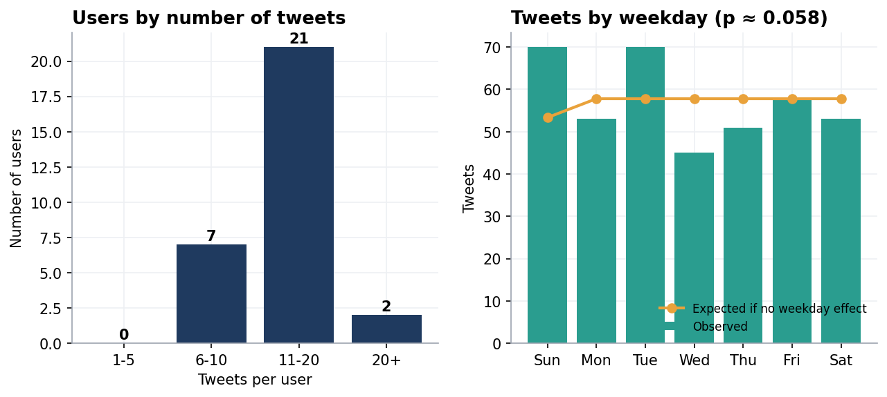

# Report · `tweets`

[← Back to project 06](../README.md)

> **Overview:** The dataset contains 400 tweets from 30 users over 90 days. The main explored questions are; *Are some users much more active than others, and does activity depend on the day of the week?*

**Script:** [`EDA practice_tweets.sql`](../sql/EDA%20practice_tweets.sql)



| Column | Meaning |
|---|---|
| `tweet_id` | unique ID (1 to 400) |
| `user_id` | author (30 users) |
| `tweet_date` | 1 Jan to 30 Mar 2024 |

## 1 · Quality checks

| Check | Result |
|---|---|
| NULLs in any column | none |
| Duplicate `tweet_id` | none (it is the primary key) |
| Repeated `user_id` + `tweet_date` pairs | **present and valid**: a person can tweet more than once a day |

- I checked repeats with `ROW_NUMBER() OVER (PARTITION BY user_id, tweet_date ORDER BY tweet_id)`. A row numbered 2 here means *a second tweet that day*, not a duplicate record. **The decision was that nothing needs cleaning.** The same pattern would be a bug in a table of orders, so the *meaning of a row* decides the answer.

## 2 · How active is each user? (histogram)

I counted tweets per user, bucketed them with `CASE` inside a CTE, then counted users per bucket with a window function.

```sql
WITH tweets_stats AS (
    SELECT user_id, COUNT(*) AS num_of_tweets,
           CASE WHEN COUNT(*) BETWEEN 1  AND 5  THEN '1-5 tweets'
                WHEN COUNT(*) BETWEEN 6  AND 10 THEN '6-10 tweets'
                WHEN COUNT(*) BETWEEN 11 AND 20 THEN '11-20 tweets'
                ELSE '20+ tweets' END AS freq
    FROM tweets GROUP BY user_id
)
SELECT DISTINCT freq, COUNT(*) OVER (PARTITION BY freq) AS freq_count
FROM tweets_stats ORDER BY freq;
```

| freq | freq_count |
|---|---|
| 11-20 tweets | 21 |
| 20+ tweets | 2 |
| 6-10 tweets | 7 |

| Tweets per user | Users |
|---|---|
| 1-5 | 0 |
| 6-10 | 7 |
| 11-20 | **21** |
| 20+ | 2 (user 9 with 21 tweets, user 17 with 25) |

- Users average **13.3 tweets** (range 8 to 25). Most people tweet at a similar rate, with only two heavy users and nobody under 8, so there is no small group generating most of the content.

> [!NOTE]
> **Why `BETWEEN` and not `> 1 AND <= 5`?** My first version of the buckets used strict comparisons that left a gap: a user with exactly 1 tweet fell into "20+". The data never triggered it, but it was a latent bug. `BETWEEN` includes both ends.

## 3 · Does the weekday matter?

`DAYNAME()` gives readable names and `DAYOFWEEK()` gives a number to sort by (1 = Sunday).

| Day | Sun | Mon | Tue | Wed | Thu | Fri | Sat |
|---|---|---|---|---|---|---|---|
| Tweets | **70** | 53 | **70** | **45** | 51 | 58 | 53 |

- The peak single day was **Monday 11 March 2024 with 9 tweets**. 4 of the 90 days had no tweets.

**Is Wednesday really quieter?** It can be seen from the output that Wednesday has the least number of tweets with 45 tweets. With a total of only 400 tweets some difference is expected by chance, so I tested it.
A **chi-square test** compares the observed counts with what you would see if every calendar day were equally busy (Sunday occurs 12 times in this window, the other days 13).

| Statistic | Value |
|---|---|
| χ² (6 degrees of freedom) | 12.21 |
| p-value | **0.058** |

A p-value above 0.05 means the weekday differences are **not statistically significant** at the usual threshold. It is borderline, so my conclusion is there is *"no reliable weekday effect in this sample"*, however this does not imply *proof of completely no weekday effect* in the data. The data are synthetic, so no real-world conclusion is intended.

> [!TIP]
> The chi-square test was run in Python (SciPy), because MySQL has no built-in chi-square. The weekday counts it used are produced by the SQL above.
