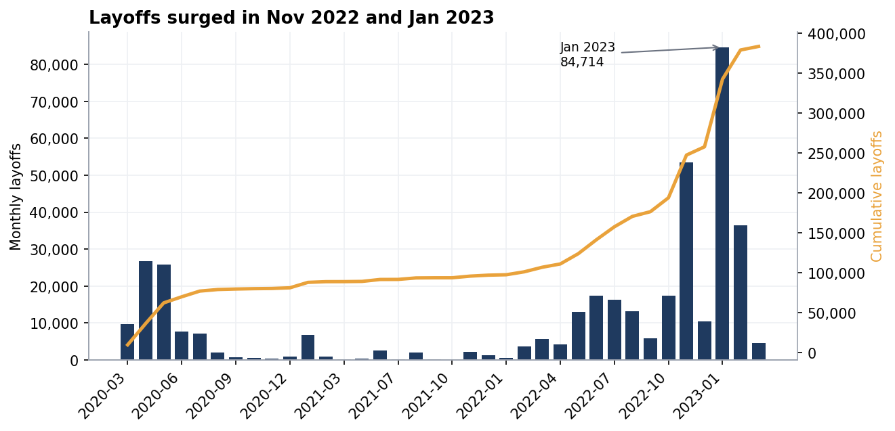
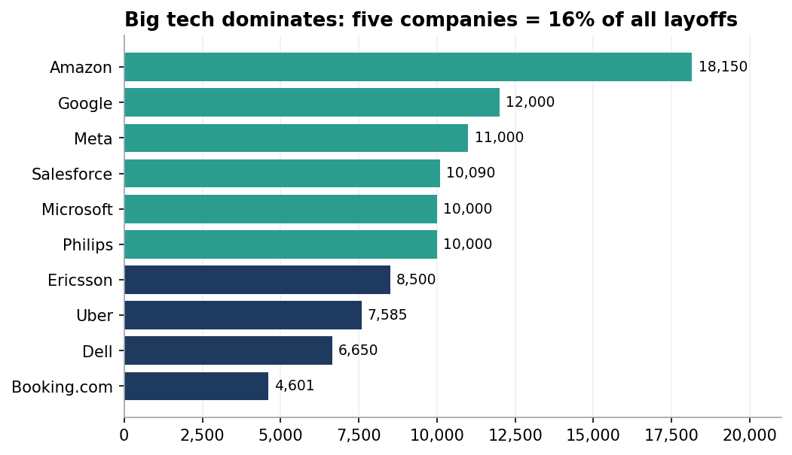
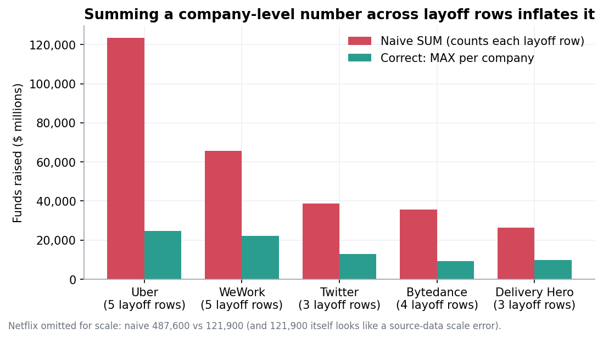
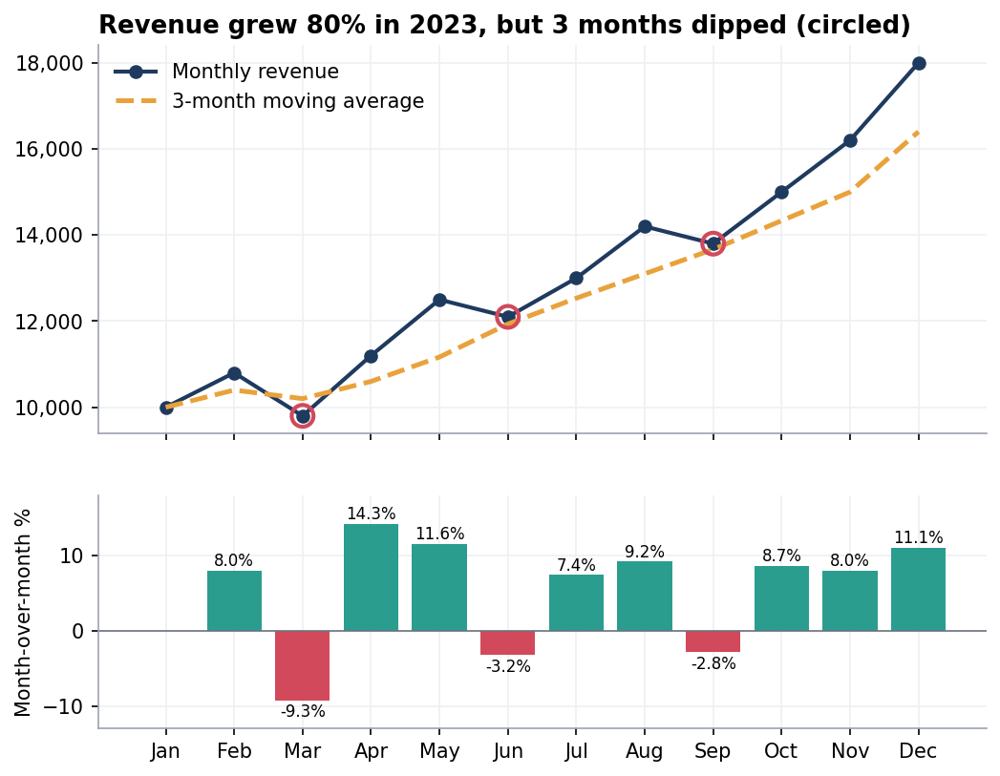
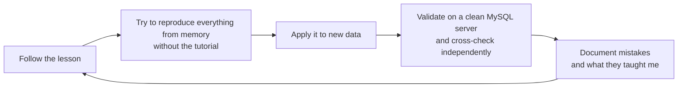

# SQL Data Analyst Portfolio

### From first `SELECT` to full exploratory analysis · MySQL 8.0


> **Hi, I'm Prince Boahen.** I’m building a career in data analysis and this repository documents my first structured SQL learning journey. I followed the *"Become a Data Analyst"* bootcamp by AlexTheAnalyst on YouTube, worked through guided projects, and applied the same skills to independent analyses **without a tutorial**. Every script was re-run on a clean MySQL 8.0 server, validated, and documented, including the mistakes I made and the corrections that followed.

Email: pursuegoals63@gmail.com

---

## What this repository shows

| | |
|---|---|
| **I clean messy data** | 2,361 raw rows reduced to 1,995 trustworthy row; I locate and correct duplicates, inconsistent labels, text dates and blanks vs NULLs |
| **I find patterns and check them** | layoffs peaked in **January 2023 (84,714)**; 5 companies = 16% of the total; US = **66.9%** |
| **I catch my own mistakes** | found that summing a per-company column across event rows made a total **almost double** (1,767,276 vs 876,286) |
| **I think before I calculate** | "never average rates" it is bad practice to simply average ratios instead of aggregating the raw values first and then finding the weighted average, "always define *duplicate* before hunting for one" you must understand what qualifies as a duplicate per the context of every work, "not every NULL is an error" there are some cases where null values are not necessarily errors|
| **I verify my work** | all the statements were re-run to ensure no outstanding errors remain; headline numbers re-computed independently; data-quality tests included |
| **I explain clearly** | every page has a simple summary and a [glossary](docs/glossary.md) |

## Start here

| # | Project | What I did | Key result | Skills |
|---|---|---|---|---|
| **01** | [SQL Fundamentals](01-sql-fundamentals/) | Lessons 1 to 7 | filtering, grouping, joins and unions on a 3-table database, with every deliberate error reproduced | `WHERE` `LIKE` `GROUP BY` `HAVING` joins `UNION` |
| **02** | [Intermediate SQL](02-intermediate-sql/) | Lessons 8 to 13 | window functions, CTEs, `CASE`, subqueries; found that a lesson's "average" was an *average of averages* | window functions CTE `CASE` subqueries |
| **03** | [Procedures, Triggers, Events, Recovery](03-procedures-triggers-events/) | Lessons 14 to 15, practice | debugged a trigger; **recovered a deleted row from the binary log** | triggers events stored procedures binlog |
| **04** | [Layoffs: Data Cleaning](04-layoffs-data-cleaning/) | Lesson 16 and independent re-do | **2,361 rows reduced to 1,995 rows**; my re-do matched the guided result exactly | staging tables `ROW_NUMBER` `STR_TO_DATE` self-join |
| **05** | [Layoffs: Exploratory Analysis](05-layoffs-eda/) | Lesson 17 and extension | two layoff waves; discovered the **funds-raised double-count** and a hidden ranking tie | aggregation rolling totals `DENSE_RANK` |
| **06** | [EDA Practice Database](06-eda-practice-database/) | independent project, 9 tables | hidden dips in "80% growth"; 50% of users never ordered; CTR pitfalls | `LAG` moving averages anti-joins conditional aggregation |

## Headline results

<table>
<tr>
<td width="50%"></td>
<td width="50%"></td>
</tr>
<tr>
<td><sub><b>Two waves:</b> spring 2020, then a far larger one from Nov 2022 to Feb 2023 (Jan 2023 alone: 84,714 people).</sub></td>
<td><sub><b>Amazon, Google, Meta, Salesforce, Microsoft/Philips</b> lead, yet the top five are only 16% of the total.</sub></td>
</tr>
<tr>
<td width="50%"></td>
<td width="50%"></td>
</tr>
<tr>
<td><sub><b>A trap I caught:</b> a company-level number repeated on every event row inflates a <code>SUM</code>.</sub></td>
<td><sub><b>80% growth, 3 down months:</b> a moving average smooths away the dips that month-over-month growth reveals.</sub></td>
</tr>
</table>

## Skills at a glance

| Area | What I can do | Where to see it |
|---|---|---|
| **Querying** | `SELECT`, `WHERE`, `LIKE`, `ORDER BY`, `LIMIT`, aliases | [01](01-sql-fundamentals/) |
| **Aggregation** | `GROUP BY`, `HAVING`, `SUM/AVG/MIN/MAX/COUNT/STDDEV`, conditional aggregation | [01](01-sql-fundamentals/), [05](05-layoffs-eda/), [06](06-eda-practice-database/) |
| **Joins & sets** | inner/left/right, self joins, multi-table, anti-joins, `UNION` | [01](01-sql-fundamentals/), [06](06-eda-practice-database/reports/users_and_orders.md) |
| **Advanced SQL** | subqueries, CTEs, window functions (`ROW_NUMBER`, `RANK`, `DENSE_RANK`, `LAG`, running totals, moving averages) | [02](02-intermediate-sql/), [05](05-layoffs-eda/), [06](06-eda-practice-database/) |
| **Data cleaning** | deduplication, standardisation, type conversion, NULL/blank handling, imputation with flags, data-quality tests | [04](04-layoffs-data-cleaning/), [tests/](tests/) |
| **Database programming** | stored procedures, triggers, events, binary-log recovery | [03](03-procedures-triggers-events/) |
| **Analytical thinking** | EDA workflow, funnel/CTR analysis, time-series, significance testing, stating limitations | [05](05-layoffs-eda/), [06](06-eda-practice-database/) |
| **Professional habits** | staging tables, documenting decisions, validation, an error log | [docs/](docs/) |

## How I worked



## Repository map

```text
sql-portfolio/
├── README.md                          ← you are here
├── setup/                             build the three databases
│   ├── 01_create_parks_and_recreation.sql
│   ├── 02_create_eda_practice.sql
│   └── 03_import_layoffs.sql
├── data/                              layoffs.csv and data dictionary
├── 01-sql-fundamentals/               lessons 1–7        (README and sql/)
├── 02-intermediate-sql/               lessons 8–13
├── 03-procedures-triggers-events/     lessons 14–15 and binary-log recovery
├── 04-layoffs-data-cleaning/          lesson 16 and independent re-do
├── 05-layoffs-eda/                    lesson 17 and independent extension
├── 06-eda-practice-database/          9-table independent project (README and reports/ and sql/)
├── tests/                             data-quality checks and corrected queries
├── docs/
│   ├── validation-report.md           how everything was verified and what was found
│   ├── debugging-log.md               every mistake and fix
│   ├── glossary.md                    SQL in plain English
│   ├── how-to-run.md                  reproduce everything
│   └── changes-from-original.md       exactly what was edited for publishing
└── images/                            charts (generated from the validated queries)
```

## Quick start

```bash
git clone https://github.com/boa-hen/sql-portfolio.git
cd sql-portfolio
mysql -u root -p < setup/01_create_parks_and_recreation.sql
mysql -u root -p < setup/02_create_eda_practice.sql
mysql --local-infile=1 -u root -p < setup/03_import_layoffs.sql
```

Then open the scripts folder of any project and run them in order. Full instructions, expected errors and troubleshooting: [`docs/how-to-run.md`](docs/how-to-run.md).

## Honest limitations

- The Parks and Recreation data are **small**, and the nine-table practice database are **small and synthetic**; they exist to practice technique, not to support real-world conclusions.
- The layoffs data are *recorded* layoffs and likely over-represent US tech. 2021 has very few events and 2023 covers only about two months, so year-to-year comparisons need care.
- `logins` and `transactions` in project 06 are **not yet analysed**. They are on the roadmap.

## Roadmap
> **These are what I plan to do next in addition to working on other new projects to consolidate my skills.**

- [ ] Finish project 06: `logins` (Day-1 retention) and `transactions` (outlier detection that avoids *outlier masking*)
- [ ] Rebuild the layoffs findings as an interactive dashboard (Tableau / Power BI)
- [ ] Repeat the full workflow on a larger, real public dataset
- [ ] Add Python for statistics and visualisation alongside SQL

## Credits

- **Course:** [*Become a Data Analyst*](https://www.youtube.com/@AlexTheAnalyst) SQL bootcamp by **AlexTheAnalyst**. Lessons 1 to 17 follow his teaching; the independent practice, validation and write-ups are my own.
- **Data:** layoffs dataset from the course (compiled from publicly reported layoffs; see [`data/README.md`](data/README.md)). Parks and Recreation sample data from the course.
- **Validation:** scripts were re-run in an isolated sandbox with the help of an AI assistant and I also personally re-run everything in MySQL Workbench multiple times; see [`docs/validation-report.md`](docs/validation-report.md).

---
<sub>If something here is unclear or wrong, please open an issue. Feedback from other learners and working analysts is very welcome.</sub>
